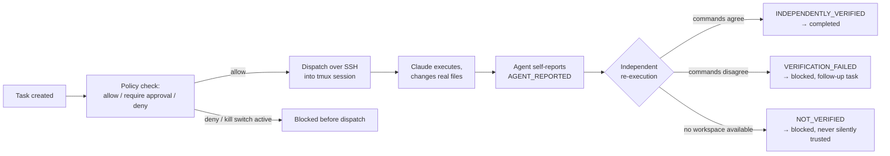

# Demo Day Q&A — WorkerAI

Prepared answers for a technical judging panel. Each answer is grounded in
verified behavior — nothing here promises more than what was actually run
and observed.

---

## Optional originality segment — "WorkerAI learns from verified outcomes" (~35s, 89 words)

Not part of the core 6:00 script (see `docs/DEMO_DAY_6MIN_SCRIPT.md` —
adding this would blow the time budget). Use it only if a judge asks
something like "does WorkerAI learn?" or "how does it improve over time?",
or as a bonus beat if time remains at 05:30.

**What's actually implemented:** `lib/agent-reliability.ts` +
`lib/adaptive-trust.ts` — a deterministic, evidence-based reliability
signal computed from real, independently-verified task outcomes (never
from an agent's self-report), feeding an advisory (not production-altering)
routing recommendation. Visually verified in the Agent detail page
(screenshot taken during development, real computed values, not mocked UI).

**Say:**

"WorkerAI learns from verified outcomes — not machine learning, but a
deterministic, auditable record of what has actually been independently
confirmed: real completions, real honest failures, real caught lies. This
agent scores 29 out of 100, built from five real observations, including
two caught lies. The score is advisory only — it never overrides a hard
safety gate or a policy decision, and it only speaks once there is enough
evidence to trust. That part is implemented; using it to actively reroute
dispatch is still a deliberate future step."

**If showing it live:** requires pre-staging — run
`set -a; source .env.local; set +a; npx tsx scripts/demo-adaptive-trust.ts`
(the **direct bash command** — `npm run demo:adaptive-trust` fails
reliably on this machine, tested 3/3, see the script/runbook for why)
before the talk to seed the clearly-labeled `[SYNTHETIC]` fixture agent,
then have a browser tab already open to its `/agents/[id]` page. The
script prints `SYNTHETIC FIXTURE DATA` throughout its own output and
cleans up after
itself — if shown live, say explicitly that the data is a synthetic
fixture built to demonstrate the algorithm, not real production history
(this repository doesn't have enough accumulated real task history yet to
show a meaningful real A-vs-B difference honestly). If not pre-staged,
skip the visual and just say the line above — it stands on its own.

---

## 1. How is WorkerAI different from existing agents?

**Short answer:** most AI coding agents stop at "the agent reports
success." WorkerAI is an evidence-driven control system that coordinates
the work *and* independently decides whether that work should be trusted
— a distinct, verified layer most agent frameworks don't have.

**Architecture (verified capabilities only):**

**Comparison — what's actually implemented here, not implied about
competitors (many general-purpose coding agents have some of these too;
the claim is the specific combination, not exclusivity of any one piece):**

| Capability | WorkerAI |
|---|---|
| Remote orchestration (SSH/tmux dispatch to real servers) | Yes — real, demonstrated live |
| Independent re-execution of the agent's own claimed result | Yes — real exit codes, not trusted self-report |
| Explicit, named verification states (not just pass/fail) | Yes — `AGENT_REPORTED` / `NOT_VERIFIED` / `INDEPENDENTLY_VERIFIED` / `VERIFICATION_FAILED` |
| Risk-based policy gate before dispatch | Yes — allow / require-approval / deny, enforced |
| File-level policy gate after execution (catches what dispatch-time risk couldn't know yet) | Yes — including gitignored files like `.env` |
| Platform-wide kill switch | Yes — fails closed on DB outage too |
| Full audit trail per task | Yes — real `AuditEvent` rows, queryable |
| Deterministic, evidence-based agent reliability scoring (Adaptive Trust Engine) | Yes — advisory only, shadow mode, never alters dispatch; see the optional segment above |
| A fully-combined real-Claude-CLI-over-SSH pipeline in one run | **Not yet verified** — see Q2 |

## 2. Is Claude actually executing the task?

**Yes, in two separately-verified ways — deliberately not merged, and we
say so:**

- `npm run demo:e2e` — the full SSH/tmux/policy/kill-switch pipeline is
  real, but the "agent" inside the disposable container is
  `fake-claude.sh`, an explicitly-labeled scripted stand-in, used so the
  mechanism (and its negative scenarios) are reproducible on demand
  without a live API dependency.
- `npm run demo:real-claude` — the real `claude` CLI, genuinely invoked, a
  real billed API call (captured: `claude` 2.1.220, $0.19, real diff, see
  `docs/DEMO_RUN_RECORD.md`).

A single run combining both (real Claude CLI, driven over real SSH/tmux,
inside the disposable container) would require mounting this machine's
Claude Code credentials into that container — judged not worth the risk
for a demo, and not attempted. If asked directly: **not verified**, and we
don't claim it is.

## 3. How do you know the result is correct?

Because WorkerAI doesn't ask the agent — it re-runs the same lint,
typecheck, test, and build commands itself, for real, against the agent's
own workspace, and only agrees with the agent if the real exit codes
agree. The demo shows this failing on purpose: the agent claims
`add(2,2) = 4` passed; independent re-execution shows `add(2,2)` actually
returns the string `"22"`, a real `AssertionError`, real exit code 1. The
task is blocked — not because we distrust the agent on principle, but
because the proof didn't hold up.

## 4. What happens when an agent fails?

Three distinct real outcomes, not one generic "failed" bucket:

- **It fails and says so** → marked failed, evidence kept.
- **It lies (reports success, re-execution disagrees)** → `VERIFICATION_FAILED`, task blocked, and an English-language follow-up task is automatically created carrying the real evidence for a human or another cycle to act on.
- **No workspace was available to check** → `NOT_VERIFIED`, also blocked — we never promote an unconfirmed claim to "verified" just because we couldn't check it.

## 5. How do you prevent unsafe operations?

Layered, not single-point: a dispatch-time risk-level policy gate (deny /
require-approval / allow) runs *before* any work starts; a file-level
policy gate runs after, against what was *actually* changed on disk
(catching things risk-level alone can't predict, like an agent touching
`.env`); approvals are scoped to one task and one category, expire on a
TTL, and are consumed on use so they can't be replayed; and a platform
kill switch halts dispatch immediately and **fails closed** — if the
database itself can't be reached to check the kill switch's own state, the
system treats that as "halted," not "proceed."

**Disclosed limitation, not hidden:** this is git-based and process-level
protection, not OS-level sandboxing — a write made entirely outside the
task's git working tree isn't visible to it. True prevention of that needs
container/VM-level isolation per task, which is a known next step, not
claimed as solved.

## 6. Why use multiple agents?

Different servers/agents can run concurrently, each with its own tmux
session, usage budget, and risk posture — so a backlog of independent
tasks doesn't serialize behind one worker, and a single misbehaving or
rate-limited agent doesn't block the rest of the fleet. This is orchestration
in the literal sense: deciding which worker gets which task, not just
running one agent in a loop.

## 7. What was technically hardest to build?

Making "independent verification" actually independent. The subtle trap
is a validation gate that *looks* like it's checking the agent's work but
can still be fooled — e.g., trusting agent-reported text when the real
workspace isn't reachable, or echoing a completion marker from the
original prompt back as "evidence." Both were real gaps found and fixed
in this codebase, each with a regression test that simulates exactly that
failure mode (a lying agent, a missing workspace, a DB outage during a
kill-switch check) to prove the fix holds, not just that it compiles.

## 8. What would you improve next?

In priority order: (1) resolve the one disclosed data-hygiene issue in
this repo's git history — a decision, not a code change; (2) attempt the
fully-combined real-Claude-CLI-over-SSH pipeline in a properly isolated
environment, with explicit authorization for the credential handling
involved; (3) OS-level sandboxing per task, to close the git-blind-spot
limitation above; (4) extend the Task Detail UI's new verification-state
display to the dashboard/task-list views, so the same clarity is visible
without opening each task individually; (5) once the Adaptive Trust Engine
has accumulated enough real (not synthetic) task history across agents,
graduate it from shadow/advisory mode to an opt-in routing signal — with
the same hard-gate and policy-approval guarantees preserved, and only
after enough real evidence exists to justify it.
