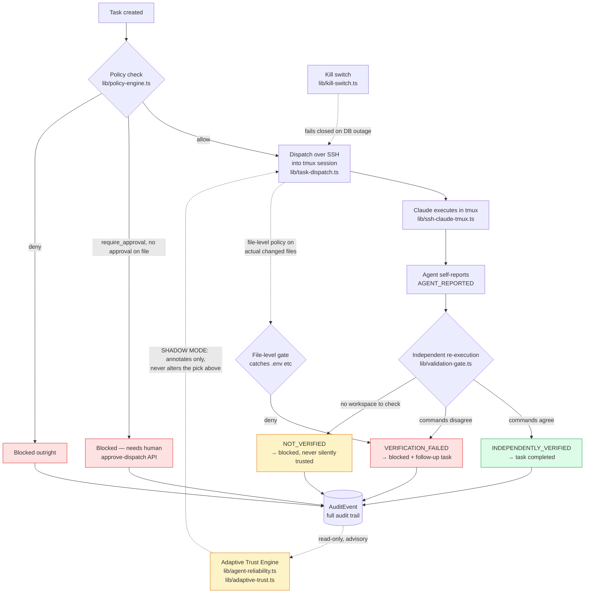

# WorkerAI Architecture — Demo Day Reference

Every box below is real, running code — not aspirational. Paths point at
the actual files.

**Reading the dotted lines deliberately**: both arrows touching the
Adaptive Trust Engine are dotted — it reads from `AuditEvent` (real history)
and only ever *annotates* a recommendation; the solid-line decision path
through policy → dispatch → validation → audit is completely unaffected by
its presence. This is enforced by construction, not convention — see the
"Adaptive Trust Engine structural isolation" appendix below.

---

## Three technically difficult problems actually solved

Scoped to the three areas that actually matter for an unsupervised
coding-agent platform — not test count, not line count.

### 1. Reliable remote execution: the dispatch prompt cannot be mistaken for its own answer

**The problem**: a task is dispatched by pasting a prompt into a live
tmux session — and that prompt, by necessity, contains an *example* of
the exact completion-block format Claude is being asked to produce (so it
knows what to output). `tmux capture-pane` returns the *entire* scrollback
when polled, including that just-pasted prompt. A naive completion
detector scanning the whole pane will match its own instructions and
report the task "done" before Claude has done anything.

**The fix**: `lib/ssh-claude-tmux.ts`'s `detectTaskCompletion()` takes an
`outputOffset` — the pane's line count *at the moment of dispatch* — and
scans only lines captured *after* that offset. The prompt's own embedded
example can never be matched, structurally, because it's always at or
before the offset. The same offset-scoped text (`scanText`, not the raw
pane) is reused for the independent-validation re-scan downstream, so the
validation block template embedded in the prompt is equally immune.

**Evidence**: `lib/__tests__/completion-marker.test.ts` — the
"marker inside prompt must not complete task" block: "does not complete
when valid block is before outputOffset" / "completes when valid block
appears after outputOffset," plus a dedicated "echoed VALIDATION template
must not be mistaken for real validation" block with its own positive and
negative cases.

### 2. Verifiable completion: an agent cannot talk its way into "verified"

**The problem**: an autonomous pipeline running unsupervised needs a
rule for "was this actually done" that a confused *or dishonest* agent
cannot satisfy just by asserting it. The hard part isn't catching an
agent that admits failure — it's the case where the agent *claims*
success and there's no way to check (no workspace). The naive
implementation silently trusts the claim in that case, because "we
couldn't check" superficially looks the same as "nothing went wrong."

**The fix**: `lib/validation-gate.ts` defines four explicit states
(`AGENT_REPORTED` / `NOT_VERIFIED` / `INDEPENDENTLY_VERIFIED` /
`VERIFICATION_FAILED`) with one invariant enforced by the type system and
control flow: `allowed: true` is reachable from exactly one branch — the
one where independent re-execution actually ran and its real exit codes
agreed. The "no workspace available" branch returns `NOT_VERIFIED`, not a
downgraded pass.

**Evidence**: `lib/__tests__/validation-gate.test.ts` — tests named around
"does not trust a passing agent report when independent re-execution
disagrees" and the NOT_VERIFIED-on-missing-workspace cases. Live proof:
`npm run demo:validation` (~2s) — a real regression introduced, a real
agent self-report of "passed," a real independent test run that fails for
real (`add(2,2) should be 4` / `'22' !== 4`), and a real verdict flip.

### 3. Risk-constrained autonomy: a deny/require-approval decision that cannot be bypassed by a different request shape

**The problem**: policy enforcement is easy to get *technically correct*
and still practically bypassable — e.g. checking risk level at dispatch
time but never re-checking what files actually got touched, or accepting
an approval that was granted for a different task or has gone stale.

**The fix**: two independent, layered gates. A dispatch-time risk gate
(`lib/task-dispatch.ts`) blocks before any work starts. A *second*,
file-level gate (`lib/validation-gate.ts` calling
`evaluatePolicy({category: "file_change", filePaths})`) runs *after*
execution against the real `git status --short --ignored=matching` output
— `--ignored=matching` specifically because a plain `git status` never
lists gitignored files, and `.env` is gitignored in virtually every
project including this one. Approvals in `lib/policy-engine.ts` are scoped
to `(taskId, category)`, carry a hard TTL, and are consumed (deleted) on
first use — so a stale or unrelated approval can't be replayed.

**Evidence**: `lib/__tests__/policy-engine.test.ts` (approval scoping,
expiry, TTL-cap, adversarial path tests). Live proof: `demo:e2e`'s Task 3
(`[TOUCHES_ENV]`) — an agent makes a correct code fix *and* writes to a
gitignored `.env`; the write is caught and completion is still blocked,
captured in `docs/DEMO_RUN_RECORD.md`.

---

## Appendix: Adaptive Trust Engine structural isolation

Not counted among the three hard problems above (it's a newer, advisory
layer, not core orchestration) — but included here because it's the
concrete answer to "how do we know the reliability signal can never
override a safety decision":

`lib/adaptive-trust.ts`'s `getAdvisoryRecommendation()` calls the
existing, unmodified `selectBestAgent()` and only *annotates* its output
— the production pick returned is always exactly what the unmodified
selector produced. Verified structurally, not just by intention: a
repo-wide grep shows the Adaptive Trust Engine's two modules are
referenced from exactly 5 files total (itself, its own read-only API
route, its own UI section, and two demo/evidence scripts) — zero
references from `lib/task-service.ts`'s real dispatch path,
`lib/task-dispatch.ts`, or `instrumentation.node.ts`. The scoring formula never self-reinforces
either: every call recomputes fresh from raw `AuditEvent` rows, nothing is
cached or fed back into future scores.

**Evidence**: `lib/__tests__/adaptive-trust.test.ts` — "matches
selectBestAgent's own pick exactly for the same input," "flags for review
but still returns the same agent," "deterministic, no self-reinforcing
loop." Reproducible evidence across 7 scenarios: `scripts/adaptive-trust-evidence.ts`.
